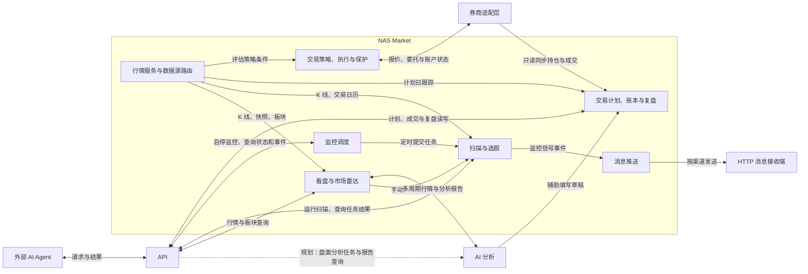
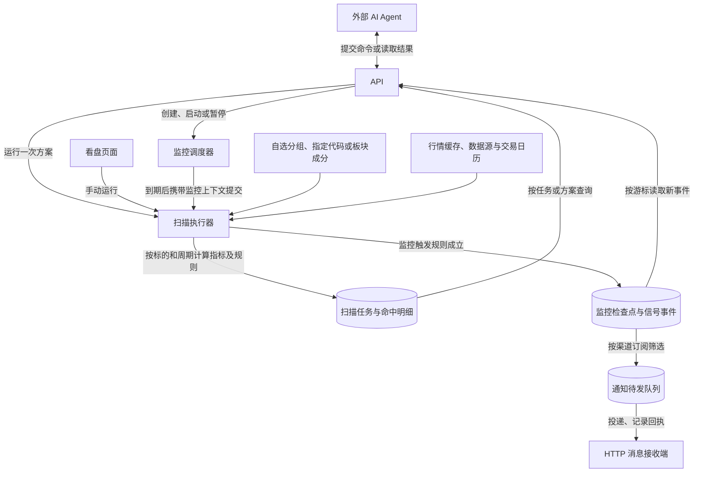
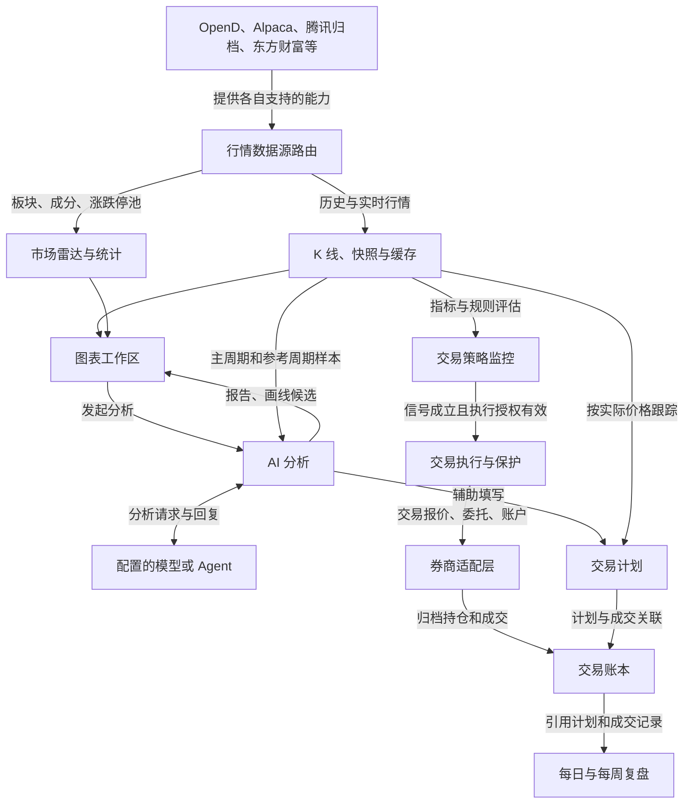

# NAS Market 开发架构

从外部 AI Agent 看，API 是统一入口。行情查询、运行扫描、管理监控和读写复盘分别交给对应的业务模块。API 返回两类容易混淆的数据：**扫描结果**回答“这次任务扫到了什么”，**监控事件**回答“从上次读取后出现了哪些新信号”。[简版架构图](images/nas-market-architecture.png)

## 系统总图

方框表示业务职责。实线表示在 2026-11-27 工作区查到的调用或数据流，虚线表示规划中的外部盘面分析接口。图中的 API 和 AI 分析各有自己的职责边界；实际进程见下文部署表。

总图把行情与板块查询放在“看盘与市场雷达”这一业务能力下。机器请求直接调用后端，无需打开网页。图左侧的外部 AI Agent 是 API **调用方**；AI 分析配置的模型或 Agent 是**分析请求的接收方**。两条链路可以使用同一产品，调用方向和凭证各自独立。

## 扫描、监控与推送

| 外部调用 | 返回与后续动作 |
| --- | --- |
| `POST /api/v1/plans/{id}/run` | 需要 `manage`。使用 `Idempotency-Key` 或请求体 `request_id` 标识同一次请求。响应包含任务 `id` 和状态；执行中通常返回 202，已完成或已暂停返回 200。 |
| `GET /api/v1/jobs/{id}` | 需要 `read`。返回任务进度和逐标的、逐周期明细。需要按方案找结果时使用 `GET /api/v1/plans/{id}/results`。提交后丢失回执时，可通过 `GET /api/v1/requests/{request_id}` 找回任务。 |
| `POST /api/v1/monitors/{id}/start` 或 `/pause` | 需要 `manage`。启停持续监控。`GET /api/v1/monitors/{id}` 读取调度状态；每次实际扫描仍有自己的任务编号。 |
| `GET /api/v1/events?monitor_id={id}&after={cursor}` | 需要 `read`。读取盘中预览或收盘确认事件。处理完本页后保存 `next_cursor`；`has_more` 为真时继续读取。 |

单次扫描命中会写任务结果。监控任务还会按触发模式、K 线和检查点判断是否新增事件，并将事件与检查点一并提交。API 查询和推送后台各自读取事件；Agent 即使未配置任何消息渠道，仍可以查询监控结果。推送后台按渠道限额投递，回执保存在通知记录中。详细字段见[扫描 API](SCANNER-API.md)和[消息推送](NOTIFICATIONS.md)。

## 行情、AI、交易与复盘

- **行情供应商与券商**分别配置。`MarketRoutes` 按美股／沪深及历史、实时、快照、板块、交易日历等能力选源。`BROKER_PROVIDER` 决定账户归档和交易执行的适配器。两者可以同时选择 OpenD。
- **AI 分析**为看盘提供多周期报告和画线候选，为计划编辑提供草稿。现有盘面分析通过浏览器接口 `POST /api/market-analysis/jobs` 提交，使用 `GET /api/market-analysis/jobs/{job_id}` 读取。外部 Agent 已能通过复盘权限调用 `POST /api/v1/review/ledger/autofill` 辅助填表；面向外部 Agent 的通用盘面分析任务 API 仍属规划。
- **交易策略监控**由交易网关轮询并调用行情服务评估条件。选股监控的产物是扫描结果和信号事件；券商委托需要交易策略的执行授权或交易台的订单提交流程。
- **两种推送**有不同的数据源和接收方。实时 K 线经 WebSocket 更新浏览器图表；信号消息来自 `scan_events`，经通知队列发送给配置的 HTTP 渠道。

## 运行与存储

| 运行位置 | 负责的工作 | 主要状态 |
| --- | --- | --- |
| 市场主进程 `app.main:app`，容器内 HTTP 8000 | 行情和实时流、雷达、扫描与调度、通知投递、分析任务、账户归档、计划日跟踪与复盘 | 行情 SQLite 库保存 K 线缓存、工作区、扫描任务、检查点、监控事件、待发通知、分析归档、计划与成交。 |
| HTTPS 交易网关 `app.trade_api:app`，8443 | 登录与会话、代理市场 API、API 凭证与通知配置、分析入口、策略轮询、交易执行与保护 | 通过行情库共享凭证和通知配置；交易流水和策略分别保存在券商对应的 SQLite 库。 |
| 外部依赖 | 行情供应商、券商、AI 助手、HTTP 消息渠道 | 各自返回行情、账户或订单状态、分析内容、消息投递回执。 |

合并部署由 `app/launch.py` 启动两个应用进程。工作区已实现按能力切换行情供应商，主进程仍装配内置 OpenD，并维护其连接状态和专用证券目录。数据源、API、AI 的逻辑边界可用于分配开发工作，无须据此推断容器数量。

## 从需求定位到代码

以 2026-11-27 本地工作区为实现基线。与 GitHub `main` 的 `c62199c` 核对时，`app/market_data.py`、`app/broker_provider.py` 和 `app/ledger_broker.py` 尚未出现在该版本的文件树中。涉及新适配层的开发和测试以含剥离改动的工作区为准。

| 开发事项 | 首先查看 | 对应测试 |
| --- | --- | --- |
| 接新行情源、切换某市场的一项能力 | `app/market_data.py` 的 `MarketRoutes`，`app/main.py` 的适配器装配；板块能力在 `app/radar.py` | `test_market_routes.py`、`test_routed_scanner.py` |
| 增加选股规则、调整任务复用或调度 | `app/scan_engine.py` 计算规则，`app/scan_service.py` 的 `submit`、`schedule`、`execute`、`record` 管理任务和事件 | `test_scan_backend.py`、`test_scan_jobs.py`、`test_scan_api.py` |
| 增加机器接口、修改凭证或网关转发 | `app/scan_api.py`、`app/review.py` 注册版本化路由，`app/chart_gateway.py` 转发，`app/api_management.py` 管理凭证与目录 | `test_scan_api.py`、`test_openclaw_market_proxy.py` |
| 改动通知筛选、重试或回执处理 | `app/notifications.py` 管理游标、待发队列和投递；`app/notification_api.py` 提供渠道配置入口 | `test_notifications.py` |
| 修改 AI 分析、图上候选或计划草稿 | `app/market_analysis.py`、`app/analysis_jobs.py`、`app/analysis_drawings.py`、`app/plan_autofill.py` | `test_market_analysis.py`、`test_analysis_jobs.py`、`test_analysis_drawings.py` |
| 接新券商、改策略执行或成交归档 | `app/broker_provider.py` 区分交易与归档能力；`app/strategy_api.py`、`app/trading.py` 负责执行；`app/ledger_broker.py` 同步成交 | `test_broker_provider.py`、`test_strategies.py`、`test_trading.py` |
| 调整交易计划、日跟踪或复盘关联 | `app/ledger.py`、`app/plan_daily.py`、`app/review.py` | `test_ledger.py`、`test_review_ledger_links.py` |

测试文件均在 `tests/`。外部 Agent 的行情、扫描和监控使用 `read`／`manage`，复盘和账本使用 `review:read`／`review:write`，图上对象使用独立画线凭证。交易操作沿用 HTTPS 会话和交易授权。
